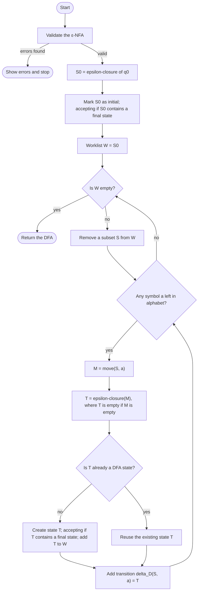

# ε-NFA → DFA Conversion Simulator

An interactive, browser-based simulator that converts an ε-NFA into an equivalent DFA using the **subset (power set) construction**. It was built as the Milestone 1 prototype for the Automata Theory and Computability course project (Bennett University).

The simulator is designed to make the conversion easy to understand, visualise and verify. It does not only show the final DFA: it records every atomic step of the algorithm and lets the user replay them.

---

## 1. Quick start

**Requirements:** a modern browser. Node.js 18+ is only needed to run the test suite.

```bash
# Run the application: open index.html directly, or serve the folder
open index.html            # macOS  (Windows: double-click index.html)
npm run serve              # then visit http://localhost:8080

# Run the automated tests
npm test
```

No installation step is needed: the project has **zero runtime dependencies**.

---

## 2. Objectives and scope

| Area | Milestone 1 (this prototype) | Milestone 2 (planned) |
|---|---|---|
| Define an ε-NFA (states, alphabet, start, finals, transitions, ε) | ✅ | |
| Graphical diagram and transition table, kept in sync | ✅ | |
| Subset construction with explicit trap state | ✅ | |
| Step-by-step execution trace and complete solution view | ✅ | |
| String testing against the DFA, with DFA-vs-ε-NFA cross-check | ✅ | |
| State explosion analysis | | ◻ planned |
| DFA minimisation | | ◻ planned |
| Language equivalence checking | | ◻ planned |
| Pumping Lemma assistant | | ◻ planned |

---

## 3. Technology stack

| Concern | Choice | Reason |
|---|---|---|
| Language | Vanilla JavaScript (ES2020+) | Runs by opening `index.html`; no build step; easy to review |
| Rendering | Hand-written SVG generator | Keeps the diagram logic pure and unit-testable |
| Styling | Plain CSS with variables | Small, self-contained palette (navy / white / light blue) |
| Testing | Node's built-in `assert` | No test-framework dependency |
| Version control | Git + GitHub | Requested by the course |

**Planned for Milestone 2:** React + TypeScript + Vite, with React Flow for the diagram editor. The current module boundaries (`automata` → `diagram` → `app`) map directly onto that structure. The Milestone 1 build deliberately uses no packages, so it can be checked and run on any machine without network access.

---

## 4. System architecture

```
┌────────────────────────────────────────────────────────────────────┐
│  index.html  +  src/styles.css                                     │
└──────────────────────────────┬─────────────────────────────────────┘
                               │ loads (in order)
   ┌───────────────────────────┼────────────────────────────────┐
   ▼                           ▼                                ▼
┌──────────────────┐   ┌─────────────────────┐   ┌─────────────────────────────┐
│ src/automata.js  │   │ src/diagram.js      │   │ src/app.js                  │
│ ENGINE (pure)    │   │ RENDERER (pure)     │   │ UI CONTROLLER               │
│                  │   │                     │   │                             │
│ • ε-closure      │   │ • SVG layout        │   │ • Single model: app.nfa     │
│ • move           │   │ • Edges, self-loops │   │ • Table & diagram editing   │
│ • validation     │   │ • Final / start /   │   │ • Converter tab             │
│ • subset constr. │   │   trap / active     │   │ • Step-by-step tab          │
│ • execution trace│   │ • Escaping          │   │ • String tester tab         │
│ • DFA simulation │   │                     │   │ • CSV export, roadmap       │
│ • verification   │   │                     │   │                             │
└──────────────────┘   └─────────────────────┘   └─────────────────────────────┘
         ▲                                                    │
         └──────────── tests/automata.test.js (Node) ─────────┘
```

**Key design decision — one source of truth.** The automaton is stored once, in `app.nfa`, as `{ states, alphabet, initial, finals, transitions }`. The transition table and the diagram are both *views* of this object. Editing either one mutates the same data, and every derived view (diagram, validation, DFA, trace) is recomputed from it. This avoids the two-inconsistent-data-structures problem the specification warns about.

**Engine/UI separation.** `automata.js` and `diagram.js` do not touch the DOM. That is why the algorithm can be tested directly in Node.

---

## 5. The algorithm

For an ε-NFA `N = (Q, Σ, δ, q₀, F)`, the subset construction builds `D = (Q_D, Σ, δ_D, S₀, F_D)` where:

- `S₀ = ε-closure({q₀})`
- `δ_D(S, a) = ε-closure(⋃_{q∈S} δ(q, a))`
- `F_D = { S ∈ Q_D | S ∩ F ≠ ∅ }`
- `Q_D` contains only the subsets reachable from `S₀`

### Pseudocode

```text
function EPSILON_CLOSURE(X):
    result ← X
    stack  ← copy of X
    while stack is not empty:
        q ← pop(stack)
        for each p in δ(q, ε):
            if p ∉ result:
                add p to result
                push p onto stack
    return result                       // handles indirect and cyclic ε-paths

function MOVE(S, a):
    return ⋃ { δ(q, a) | q ∈ S }        // ∅ if no state in S has an a-transition

function SUBSET_CONSTRUCTION(N):
    validate N                           // stop with messages if invalid
    S₀ ← EPSILON_CLOSURE({q₀})
    Q_D ← { S₀ };  F_D ← ∅;  W ← [S₀]    // W is a worklist of unprocessed states
    if S₀ ∩ F ≠ ∅ then F_D ← { S₀ }
    while W is not empty:
        S ← pop(W)
        for each a in Σ:
            M ← MOVE(S, a)
            T ← EPSILON_CLOSURE(M)       // T = ∅ when M = ∅
            if T ∉ Q_D:                  // canonical subsets prevent duplicates
                Q_D ← Q_D ∪ { T };  push T onto W
                if T ∩ F ≠ ∅ then F_D ← F_D ∪ { T }
            δ_D(S, a) ← T
    return (Q_D, Σ, δ_D, S₀, F_D)
```

### Flowchart



### Design notes on the requirements

- **Canonical subsets.** Each subset is stored as a sorted list of state names, so `{q2, q1}` and `{q1, q2}` are the same DFA state.
- **Worklist.** Only reachable subsets are generated; unreachable NFA states never create DFA states (tested).
- **Empty subset.** When a move is empty, the target is `∅`. It becomes an explicit **trap state** with a self-loop on every symbol. It is created only when reached, never added by default.
- **Multiple destinations.** A table cell can contain several states, and `move` takes their union.
- **Multiple consecutive and cyclic ε-transitions.** The closure is a graph search with a visited set, so it terminates on cycles.

---

## 6. Application workflow

1. **Define** the automaton: states, alphabet, start state and accepting states (left panel).
2. **Draw or tabulate** the transitions. Use "+ Add transition" and click a source and a destination in the diagram, then choose the symbol (or ε). Or type destinations directly into the table cells. Either way, both views update.
3. **Convert** with "Convert to DFA". The DFA states, transition table and diagram appear. After this, the DFA updates live as the automaton changes.
4. **Step through** the conversion in the *Step-by-Step Solution* tab: Previous, Next, Play, Reset, or click any log line. The NFA diagram highlights the current subset, and the DFA diagram grows as states are discovered.
5. **View the complete solution:** ε-closures, the subset derivation table, the DFA tuple, and the full log.
6. **Test strings** in the *String Tester* tab. Each symbol shows the DFA transition. The ε-NFA is simulated independently, and an exhaustive check compares the two up to a chosen length.

**Editing shortcuts:** drag a state to rearrange the diagram; rename a state in the left panel; press Enter in a table cell to commit it.

---

## 7. Manually verified example

**Input:** the built-in *Textbook ε-NFA* sample.

- States `Q = {q0, q1, q2, q3}`, alphabet `Σ = {a, b}`, start `q0`, final `F = {q3}`.
- Transitions: `q0 —ε→ q1`, `q1 —ε→ q2`, `q2 —ε→ q1` (an ε-cycle), `q1 —a→ {q2, q3}`, `q1 —b→ q3`, `q2 —b→ q0`.

**Hand-derived ε-closures:** `cl(q0) = {q0, q1, q2}`, `cl(q1) = cl(q2) = {q1, q2}`, `cl(q3) = {q3}`.

**Derivation (worked by hand, then checked by the program):**

| DFA state | Subset S | move(S, a) → closure | move(S, b) → closure | Accepting |
|---|---|---|---|---|
| **D0** (start) | `{q0, q1, q2}` | `{q2, q3}` → `{q1, q2, q3}` = **D1** | `{q0, q3}` → `{q0, q1, q2, q3}` = **D2** | no |
| **D1** | `{q1, q2, q3}` | `{q2, q3}` → `{q1, q2, q3}` = D1 | `{q0, q3}` → `{q0, q1, q2, q3}` = D2 | yes |
| **D2** | `{q0, q1, q2, q3}` | `{q2, q3}` → `{q1, q2, q3}` = D1 | `{q0, q3}` → `{q0, q1, q2, q3}` = D2 | yes |

**Expected result:** 3 DFA states, no trap state (no empty subset is reachable), accepting states `{D1, D2}`.

**Language:** every transition leads to D1 or D2, and both are accepting. Therefore the DFA accepts exactly the non-empty strings over `{a, b}`: `L = Σ⁺`. The empty string is rejected because D0 is non-accepting.

The automated suite asserts this table exactly, and checks all 255 strings of length ≤ 7 against the ε-NFA.

### Second example — explicit trap state

The *Language {a}* sample (`q0 —a→ q1`, `F = {q1}`) gives:

| DFA state | Subset | a | b | Accepting |
|---|---|---|---|---|
| D0 (start) | `{q0}` | D1 | D2 | no |
| D1 | `{q1}` | D2 | D2 | yes |
| D2 (trap) | `∅` | D2 | D2 | no |

`b` from `q0` has no destination, so the subset is `∅`. That becomes the trap state, which is the only case where it is needed.

---

## 8. Testing

Run `npm test`. The suite (`tests/automata.test.js`) covers:

| Requirement | How it is tested |
|---|---|
| ε-transition from the initial state | Textbook closure of q0 |
| Multiple consecutive ε-transitions | Chain p0 → p1 → p2 → p3 |
| Cyclic ε-transitions | q1 ⇄ q2 terminates correctly |
| Multiple destinations per symbol | `move({q1}, a) = {q2, q3}` |
| Missing transitions | `move` on an undefined transition returns ∅ |
| Automaton generating the empty subset | Trap sample: explicit trap, self-loops |
| Multiple accepting states | Accepting-start sample has two finals |
| Initial state that is also accepting | Accepting-start sample; empty string accepted |
| Empty input string | Accepted and rejected cases |
| Accepted and rejected strings | Explicit DFA runs on each sample |
| Language preservation | 300 seeded random ε-NFAs, all strings up to length 5, DFA ≡ ε-NFA |
| Unreachable states | Unreachable NFA state creates no DFA state |
| Validation | Missing start, undefined finals, invalid endpoints, bad symbols, duplicates |
| Trace integrity | Start/complete bookends; one transition per (state, symbol) |
| Renderer safety | Labels are escaped; edges to unknown nodes are skipped |

**Result at the time of writing:** `npm test` passes all 33 engine and renderer tests (including 300 randomized equivalence cases) and all 21 UI smoke-test checks.

**UI verification (`tests/ui-smoke.test.js`):** the real `app.js` is run in a sandbox with a stub DOM, covering tab switching, navigation, conversion, the test runner, sample loading, renaming, invalid-input messages, table edits, and diagram-driven transition creation. The check confirms that a transition added in the diagram appears in the table. **Not yet done:** a visual check in a real browser, and captured screenshots for the Milestone 1 report. These should be taken by running the app.

---

## 9. Project structure

```
enfa-dfa-simulator/
├── index.html              # Entry point (open in a browser)
├── package.json            # npm scripts: test, serve (no dependencies)
├── README.md
├── .gitignore
├── src/
│   ├── automata.js         # ENGINE: model, ε-closure, move, validation, subset construction, simulation
│   ├── diagram.js          # RENDERER: SVG generation for automaton graphs
│   ├── app.js              # UI CONTROLLER: single model, tabs, editing, step-by-step, tester
│   └── styles.css          # Visual design
└── tests/
    └── automata.test.js    # Node test suite (engine + renderer + random cross-check)
```

---

## 10. Limitations

- Edges cannot yet be selected and edited in the diagram; delete or change them through the table.
- The diagram layout is circular by default. States can be dragged, and positions are kept for the session but not saved to a file.
- Import and export are limited to CSV tables. Saving or loading full automata is not implemented.
- No visual regression tests. The UI is checked by the stub-DOM smoke test and by manual use.

---

## 11. Git and GitHub

```bash
cd enfa-dfa-simulator
git init
git add .
git status                       # confirm no node_modules, build output, or secrets
git commit -m "Milestone 1: ε-NFA to DFA simulator with subset construction, step trace and tests"
git branch -M main
git remote add origin <YOUR_GITHUB_REPOSITORY_URL>
git push -u origin main
```

---

## 12. Milestone 2 roadmap

1. **State explosion analysis:** plot the reachable DFA size against the 2ⁿ bound, for generated families of NFAs.
2. **DFA minimisation:** Hopcroft partition refinement, with the minimised DFA checked by the same equivalence routine.
3. **Language equivalence:** product construction and an emptiness test on the symmetric difference.
4. **Pumping Lemma assistant:** an interactive game in which the user proposes a decomposition `xyz` and the tool checks the three pumping conditions.
5. **Migration:** React + TypeScript + Vite, React Flow for the editor, and unit tests carried over from the current suite.
6. **Diagram editing:** select and edit or delete individual transitions directly on the graph.

---

## Academic note

The application is an educational tool. It follows the textbook subset construction. Each DFA state is generated only from an algorithm step, never hard-coded. The sample automata and their expected results are included to support the Milestone 1 verification requirement.
